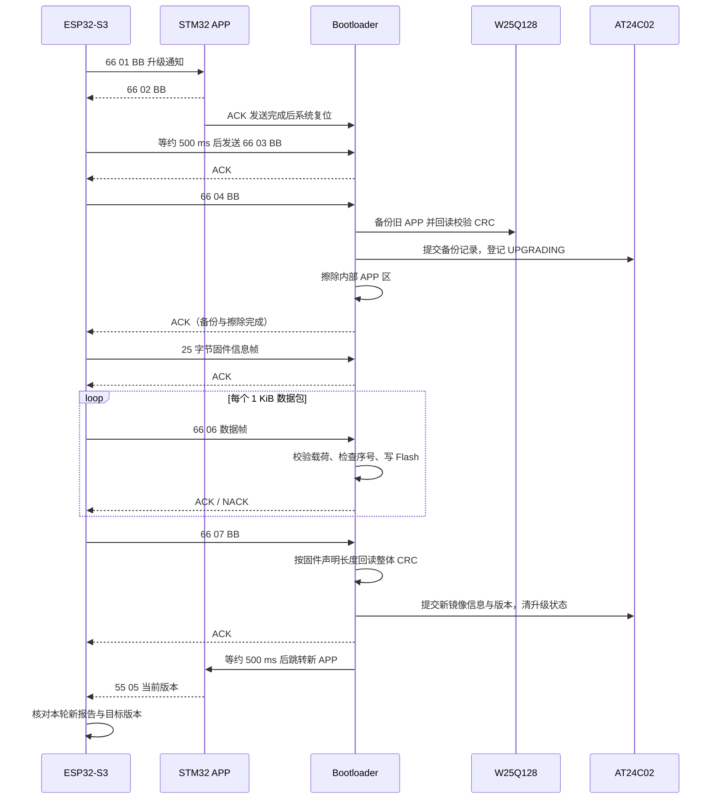

# ESP32-S3 + STM32F407 双端 OTA：引脚、协议与运行逻辑

> 核对日期：2026-10-22。依据当前工作区源码及工程配置整理，包含尚未提交的改动。本文描述代码现状，不表示本次已编译、烧录或完成实机回归。旧版 TXT 保留不动。

## 阅读导航

| 要查什么 | 对应章节 |
|---|---|
| 两块板怎么接线，各外设占哪些脚 | [2. 引脚与连接](#2-引脚与连接) |
| 升级命令、数据包、CRC 怎么算 | [3. OTA 串口协议](#3-ota-串口协议) |
| 温湿度、烟雾、光照、版本如何上报 | [4. APP 业务协议](#4-app-业务协议) |
| 从平台下发到新版 APP 启动的顺序 | [5. 完整 OTA 流程](#5-完整-ota-流程) |
| 掉电、超时和回滚如何处理 | [6. 存储与恢复](#6-存储与恢复) |
| 任务分工、报警、配置保存 | [7. APP 运行逻辑](#7-app-运行逻辑) |
| 代码与旧说明有哪些差异 | [8. 当前边界与易混点](#8-当前边界与易混点) |
| 去哪里找实际实现 | [9. 源码索引](#9-源码索引) |

## 1. 工程范围与职责

本文中的“双端”指 ESP32-S3 网关端与 STM32F407 设备端；STM32 端又分为 Bootloader 和 APP 两套固件。

| 代码范围 | 作用 | 主要入口 |
|---|---|---|
| `ESP32S3-OTA` | Wi-Fi、OneNET、固件下载、UART 升级调度、业务上报 | `app_main()`、`ota_manager_task()` |
| `STM32-OTA/testB3` | 启动检查、旧 APP 备份、接收固件、擦写、CRC、回滚、跳转 | `Task_Main()`、`Task_While()`、`OTA_RunUpgradeProcess()` |
| `STM32-OTA/A区智能哨兵环境监测系统` | FreeRTOS、LVGL、传感器、执行器、业务通信 | `main()`、`MX_FREERTOS_Init()`、`AppTasks_Create()` |

```text
OneNET
  │ MQTT：物模型、OTA 通知    HTTP：OTA 查询、固件下载、结果上报
  ▼
ESP32-S3 网关
  │ UART1 ↔ USART2，同一根链路分阶段使用
  ├── STM32 APP：55 业务帧；66 01 升级通知；66 09 版本查询
  └── STM32 Bootloader：66 OTA 命令、固件信息、数据、ACK/NACK
          ├── STM32 内部 Flash：Bootloader + 单 APP 区
          ├── W25Q128：一份升级前的可信 APP 备份
          └── AT24C02：当前镜像信息、版本、备份记录、升级状态
```

**A 区是 APP，B 区是 Bootloader。** 本工程没有两份可轮换运行的 STM32 内部 APP 镜像。

## 2. 引脚与连接

### 2.1 双 MCU 通信接线

| 信号方向 | ESP32-S3 | STM32F407 | 用途 |
|---|---|---|---|
| ESP32 → STM32 | GPIO45 / UART1_TX | PA3 / USART2_RX | 升级命令、固件、业务 ACK、心跳 |
| STM32 → ESP32 | GPIO46 / UART1_RX | PA2 / USART2_TX | OTA ACK/NACK、业务数据、版本 |
| 公共参考地 | GND | GND | 两端共地 |

代码配置为 **115200 bit/s、8 数据位、无校验、1 停止位，无 RTS/CTS**。接线采用板间 TTL 串口，TX 接对端 RX；电源及逻辑电平应按实际板卡核对。

| STM32 运行阶段 | USART2 接收方式 | 发送方式 |
|---|---|---|
| Bootloader | DMA 接收，结合空闲中断和环形缓冲处理 | OTA 协议函数发送 ACK/NACK |
| APP | 单字节接收中断 → 软件环形缓冲 → 通信任务组帧 | `UART2_Comm_Task` 统一启动 TX DMA |

Bootloader 配置 RX 为 DMA1 Stream5 / Channel4，TX 为 DMA1 Stream6 / Channel4。APP 也保留 RX DMA 初始化，但当前实际接收入口为单字节中断，不能据此写成“APP 使用 DMA 接收”。

依据：源码索引 S1、S5、S9。

### 2.2 ESP32-S3 应用 GPIO

| 引脚 | 当前代码配置 | 说明 |
|---|---|---|
| GPIO45 | UART1_TX | 双 MCU 链路 |
| GPIO46 | UART1_RX | 双 MCU 链路 |
| GPIO15 | LEDC 通道 0，12 位、5 kHz | 本地亮度控制资源；部分调光调用已注释，不能仅凭初始化认为调光闭环已启用 |
| GPIO16 | 普通输出、下拉 | ESP32 本地灯开关 |
| GPIO18 | WS2812 数据输出，3 颗灯 | ESP32 本地 RGB 灯 |

ESP32 本地灯控与 STM32 的 PF10 照明灯是不同硬件。不能把 ESP32 收到的本地灯控属性直接理解成 STM32 已收到远程控制帧。Wi-Fi 由 ESP32 内部无线功能承担。

依据：S1、S4。

### 2.3 STM32 公共接口与 Bootloader 存储接口

| 模块 | 引脚 | 当前用途 |
|---|---|---|
| USART2 | PA2 / PA3 | TX / RX，连接 ESP32 |
| USART1 | PA9 / PA10 | TX / RX，调试日志；Bootloader 和 APP 均配置 115200 |
| W25Q128 | PB3 / PB4 / PB5 | SPI1 SCK / MISO / MOSI |
| W25Q128 | PB14 | CS，低电平选中，Bootloader 初始化时拉高 |
| AT24C02 | PB8 / PB9 | SCL / SDA；Bootloader 使用硬件 I2C1，APP 使用软件 I2C |
| SWD | PA13 / PA14 | SWDIO / SWCLK，调试接口 |
| HSE | PH0 / PH1 | `.ioc` 中的外部高速晶振引脚 |
| LSE | PC14 / PC15 | `.ioc` 中有低速晶振占用；不等于运行时一定开启 LSE |

Bootloader 的 SPI1 配置为主机、8 位、MSB 先发、CPOL 低、第一边沿采样、软件片选、预分频 8。这里记录工程配置，不扩展为所有板卡必须采用的配置。

APP 与 Bootloader 先后运行，复用同一 AT24C02。APP 不能覆盖 Bootloader 元数据区域，具体地址见第 6 节。

依据：S5、S7、S12。

### 2.4 STM32 APP 传感器与执行器

| 模块 | 引脚 | 软件配置及作用 |
|---|---|---|
| SHT30 Modbus 模块 | PB10 / USART3_TX | 接外部 TTL-RS485 模块的接收输入，9600 8N1 |
| SHT30 Modbus 模块 | PB11 / USART3_RX | 接外部 TTL-RS485 模块的发送输出 |
| RS485 方向 | 无 MCU 控制脚 | 当前收发代码没有 DE/RE 控制；自动方向模块的实际接法需与硬件一致 |
| MQ-2 | PA1 / ADC1_IN1 | 单次软件触发、12 位 ADC，上传原始值 0～4095 |
| BH1750 | PB6 / PB7 | 独立软件 I2C，SCL / SDA；驱动使用 7 位地址 `0x23` |
| 风扇 1 | PE5 / TIM9_CH1 | PWM 控制输入 |
| 风扇 2 | PE6 / TIM9_CH2 | PWM 控制输入；业务层与风扇 1 同步 |
| 蜂鸣器 | PF8 | 高电平响、低电平停，按 APP 写脚逻辑 |
| 红色报警灯 | PF9 | 低电平亮 |
| 绿色照明灯 | PF10 | 低电平亮 |

风扇驱动将 TIM9 计数频率设置为 10 kHz，周期 100 个计数，目标 PWM 为 **100 Hz**；占空比范围为 0～100%。引脚接的是驱动控制输入，具体 MOS 管、电机电源和供电能力不能仅从源码确认。

历史 DHT11 的 PG9、历史风扇 PG14/PG15 不属于当前正式采集和 PWM 控制主链。不要按旧接线说明替代 PE5/PE6。

依据：S9、S10、S11。

### 2.5 LCD 与 SRAM 共用的 FSMC 总线

下表记录 BSP 初始化占用的总线引脚。LCD、SRAM 共用数据线和读写线，使用不同片选。

| 总线资源 | 引脚组 | 使用者 |
|---|---|---|
| 16 位数据线 | PD0、PD1、PD8～PD10、PD14、PD15；PE7～PE15 | LCD、SRAM 共用 |
| 读 / 写 | PD4 / PD5 | LCD_RD、SRAM_RD / LCD_WR、SRAM_WR |
| LCD 片选 | PG12 | FSMC Bank4 / NE4 |
| LCD 寄存器选择 | PF12 | 地址线 A6，用于命令 / 数据选择 |
| LCD 背光 | PB15 | GPIO 背光开关 |
| SRAM 地址线 | PF0～PF5、PF12～PF15；PG0～PG5；PD11～PD13 | 外部 SRAM 地址总线 |
| SRAM 字节选通 | PE0 / PE1 | NBL0 / NBL1 |
| SRAM 片选 | PG10 | NE3 |

### 2.6 触摸与按键资源

| 路径 | 引脚 | 说明 |
|---|---|---|
| 电容触摸软件 I2C | PB0 / PF11 | SCL / SDA |
| 电容触摸辅助脚 | PB1 / PC13 | INT / RST，具体驱动按屏型号选择 |
| 电阻触摸备用路径 | PB0、PB1、PB2、PF11、PC13 | CLK、PEN、MISO、MOSI、CS |
| 板载按键驱动 | PE4、PE3、PE2、PA0 | KEY0、KEY1、KEY2、WK_UP；驱动定义不代表当前业务全部使用 |

电容和电阻触摸是按屏幕选择的不同路径，共用引脚不能理解成两套触摸同时工作。LCD、SRAM 和触摸均为板级资源，接线应结合实际屏幕与原理图确认。

依据：S12。

## 3. OTA 串口协议

### 3.1 通用约定

| 项目 | 约定 |
|---|---|
| 帧头 / 帧尾 | `66` / `BB`，均为十六进制字节 |
| 简单命令 | `66 cmd BB`，3 字节 |
| OTA ACK | `66 02 BB`，3 字节 |
| OTA NACK | `66 0A error BB`，4 字节 |
| 多字节整数 | UART 协议中采用大端，高字节先发 |
| 数据分包 | 包序号从 0 开始，最大载荷 1024 字节 |
| 传输调度 | 停等：当前帧收到 ACK 后才发下一帧 |

固件数据本身可以包含 `66`、`BB`，不能把载荷中的任意 `BB` 当作结束。数据帧按长度字段确定 CRC 和帧尾位置；当前 Bootloader 再结合 DMA/空闲接收结果解析，并非完整的任意字节流重组协议。

### 3.2 命令表

| cmd | 方向 | 作用 | 接收阶段 |
|---|---|---|---|
| `01` | ESP32 → STM32 | 升级通知；APP 回 ACK 后复位 | APP |
| `02` | STM32 → ESP32 | OTA ACK | APP 通知应答、Bootloader 各阶段 |
| `03` | ESP32 → STM32 | 复位后二次握手 | Bootloader 握手窗口 |
| `04` | ESP32 → STM32 | 建立旧 APP 备份、登记升级状态、擦除 APP | Bootloader `WAIT_START` |
| `05` | ESP32 → STM32 | 固件大小、版本、整体 CRC、信息帧 CRC | Bootloader `WAIT_INFO` |
| `06` | ESP32 → STM32 | 固件数据包 | Bootloader `WAIT_DATA` |
| `07` | ESP32 → STM32 | 结束；按声明长度校验内部 Flash 整包 CRC 并提交元数据 | Bootloader 数据 / 结束阶段 |
| `08` | ESP32 → STM32 | ABORT，结束本次传输；擦除后需恢复旧 APP | Bootloader |
| `09` | ESP32 → STM32 | 查询运行中的 APP 版本，响应为 `55 05 ... BB` | APP |
| `0A` | STM32 → ESP32 | NACK，附 1 字节错误码 | Bootloader |

`66 09 BB` 不等待 `66 02 BB`。它的响应是业务版本帧，交给 ESP32 普通接收任务处理。

### 3.3 固件信息帧：固定 25 字节

```text
66 05 size[4] 2F 2F version[8] firmware_crc32[4] frame_crc32[4] BB
```

| 字节偏移 | 长度 | 字段 | 含义 |
|---|---:|---|---|
| 0 | 1 | head | `66` |
| 1 | 1 | cmd | `05` |
| 2～5 | 4 | size | 实际 BIN 长度，大端，不包括尾包填充 |
| 6～7 | 2 | separator | `2F 2F` |
| 8～15 | 8 | version | ASCII，例如 `v2.0.2`；不足 8 字节补 `00` |
| 16～19 | 4 | firmware_crc32 | 对实际 BIN 全部字节计算的 CRC32，大端 |
| 20～23 | 4 | frame_crc32 | 对偏移 1～19 共 19 字节计算的 CRC32，大端 |
| 24 | 1 | tail | `BB` |

整体 CRC 用来验证“写入内部 Flash 的固件是否正确”；信息帧 CRC 用来验证“本帧大小、版本和整体 CRC 字段是否传坏”。两者用途不同。

### 3.4 固件数据帧：13 + N 字节

```text
66 06 seq[2] len[4] payload[N] payload_crc32[4] BB
```

| 字节偏移 | 长度 | 字段 | 含义 |
|---|---:|---|---|
| 0～1 | 2 | head、cmd | `66 06` |
| 2～3 | 2 | seq | 包序号，大端，从 0 开始 |
| 4～7 | 4 | len | 本帧载荷字节数 N，大端，最大 1024 |
| 8～7+N | N | payload | 固件数据 |
| 8+N～11+N | 4 | payload_crc32 | 只对载荷计算，大端 |
| 12+N | 1 | tail | `BB` |

**当前 ESP32 会话始终发送 N=1024 的数据包，每帧 1037 字节。** 尾包不足 1024 字节时补 `FF`。STM32 先校验整段载荷 CRC，再按固件剩余长度裁剪写入量。最终整体 CRC 只计算实际 BIN 长度，不包括链路填充。

例：BIN 为 2050 字节，发 3 包，序号 0、1、2；最后一包传 2 字节有效数据和 1022 字节 `FF`，STM32 最后只计入 2 字节。底层为字对齐写入而补的 `FF` 同样不算有效固件长度。

数据 CRC **不覆盖命令、序号、长度**。这些字段由格式检查、状态和序号检查约束，不能写成“整帧所有字段都有 CRC 保护”。

### 3.5 CRC32 参数

| 参数 | 当前实现 |
|---|---|
| 逐位计算方式 | 右移，反射实现 |
| 反向多项式 | `0xEDB88320` |
| 初值 | `0xFFFFFFFF` |
| 最终异或 | `0xFFFFFFFF` |
| 标准校验参考 | ASCII `123456789` → `0xCBF43926` |

ESP32 的 `calculate_crc32()` / `crc32_stream_*()` 与 STM32 的 `OTA_CalcCRC32()` 使用同一算法。CRC32 是完整性检查，不能替代固件签名。

### 3.6 NACK 错误码

| error | 含义 | ESP32 当前动作 |
|---|---|---|
| `01` | 帧 CRC / 解析失败 | 在单帧次数上限内重发 |
| `02` | 状态不匹配 | 当前发送返回失败，收尾发 ABORT，按外层策略处理 |
| `03` | 非法帧长 | 在单帧次数上限内重发 |
| `04` | Flash / 存储错误 | 结束当前轮，等待最终版本并上报结果 |
| `05` | 固件整体 CRC 错误 | 结束当前轮，等待最终版本并上报结果 |
| `06` | 未知命令 | 当前单帧发送立即失败，不在该函数里按可恢复码重发 |
| `07` | 包序号异常 | 在单帧次数上限内重发 |
| `08` | 已回滚，上一轮会话必须结束 | 停止旧会话，核对恢复后的实际版本 |

错误码是当前实现的反馈分类，不保证唯一对应某一种根因。例如信息帧解析失败也可能统一返回 `01`。

### 3.7 超时与重试

| 层级 / 阶段 | 当前数值 | 说明 |
|---|---|---|
| ESP32 普通 OTA 帧 | 每次 8000 ms，最多发送 5 次 | 包括首次发送，不是首次再重发 5 次 |
| APP ACK 后启动缓冲 | 500 ms | ESP32 等 STM32 复位和串口初始化 |
| ESP32 `03` | 每次 500 ms，最多发送 8 次 | 与 Bootloader 5 秒握手窗口配合 |
| ESP32 `04` | 20000 ms，只发送 1 次 | 等备份和擦除；超时结束旧会话 |
| ESP32 ABORT | 每次 500 ms，最多发送 2 次 | 收尾有界等待 |
| ESP32 整体 UART 传输 | 最多尝试 3 轮 | 不可恢复错误会提前结束；不是 3 次额外重试 |
| Bootloader 普通握手窗口 | 5000 ms | 无升级请求时按检查结果跳 APP |
| Bootloader 恢复通知窗口 | 10000 ms | 用于结束掉电 / 超时前的旧会话 |
| Bootloader 等 `04` / 信息 / 数据 | 各 15000 ms | 数据阶段成功收包会刷新截止时间 |
| Bootloader 等 `07` | 10000 ms | 接收够固件长度后进入该阶段 |

Bootloader 头文件还定义了 `OTA_FRAME_TIMEOUT_MS=3000`、`OTA_MAX_RETRY_COUNT=3`。当前主状态机的退出主要由上述阶段截止时间控制，不能把这两个宏直接描述成已生效的“每包 3 秒、内部重发 3 次”。

收到上一包的重复包时，`WAIT_DATA` 中会补 ACK，不重复写 Flash。但最后一包接收后已进入 `WAIT_END`，当前不能保证该阶段也接受末包重发；各类 ACK 丢失不能笼统视为全部可无损恢复。

依据：S2、S3、S6。

## 4. APP 业务协议

### 4.1 固定 8 字节帧

```text
字节：  0    1       2      3      4      5      6     7
内容： 55   type   data0  data1  data2  data3  data4   BB
```

业务帧和 OTA 帧复用同一条串口，但处理阶段不同。业务帧当前没有 CRC、序号或会话 ID。

### 4.2 STM32 → ESP32 上报

| type | 数据含义 | data0 | data1 | data2 | OneNET 属性 / 去向 |
|---|---|---|---|---|---|
| `01` | 湿度 | 整数 %RH | 0 | 0 | `hum` |
| `02` | 温度 | 整数 ℃ | 0 | 0 | `temp` |
| `03` | 实际照明状态 | 0=灭，1=亮 | 0 | 0 | `LED` |
| `04` | 逻辑报警状态 | 0=无，1=烟雾报警或手动蜂鸣器开启 | 0 | 0 | `Alarm` |
| `05` | 当前 APP 版本 | major | minor | patch | OTA Manager 版本队列，不进物模型队列 |
| `06` | MQ-2 ADC 原始值 | 高字节 | 低字节 | 0 | `Smoke` |
| `07` | 整数照度 lx | 高字节 | 低字节 | 0 | `Lux` |
| `08` | 双风扇最终占空比 | 0～100 | 0 | 0 | `Fan` |

表中所有帧的 data3、data4 均为 0。`06` / `07` 的数值为 `(data0 << 8) | data1`。`Smoke` 是 ADC 原始值，不是标定后的 ppm。风扇占空比是软件输出值，不是测速结果。

温湿度在 STM32 内部保留 ×10 定点数和一位小数显示，串口发送前四舍五入为整数；温度负值按 0 发送，湿度上限截断到 100。当前云端业务格式不支持负温度和 0.1 精度。

`Alarm=1` 表示逻辑报警有效，不随蜂鸣器 200 ms 响 / 800 ms 停逐次翻转；温湿度超限只开风扇，不单独把该属性置 1。

### 4.3 ESP32 → STM32 业务 ACK

```text
55 7E result 00 00 00 00 BB
```

| result | 含义 |
|---|---|
| `00` | 普通属性已进入 ESP32 队列；版本已进入版本缓存队列 |
| `01` | 格式、类型或参数不符合当前实现要求 |
| `02` | ESP32 物模型队列满，本次未入队 |

**业务 ACK 不是云端确认。** ESP32 成功入队后，数据还需经属性缓存和 MQTT 上报。STM32 不等待 OneNET 平台响应。

STM32 单帧等待业务 ACK 200 ms，首次发送后最多重发 3 次，共最多 4 次。非零 ACK 会促使下一轮立即重试；超过上限丢弃当前业务帧。因为 ACK 没有序号，必须串行发送，仍存在延迟 ACK 错配和重发产生重复数据的边界。

### 4.4 心跳与版本查询

| 功能 | 请求 / 下行帧 | 返回 / 处理 |
|---|---|---|
| 云连接心跳 | `55 0A status 00 00 00 00 BB` | status=0 离线、1 在线；STM32 不回业务 ACK |
| APP 版本查询 | `66 09 BB` | STM32 安排重发 `55 05 major minor patch 00 00 BB` |

ESP32 每约 5 秒发送心跳，状态来自本地 MQTT 连接判断；STM32 超过 15 秒未收到心跳则显示 `NC`。这不是端到端云服务可用性测量。OTA 占用 UART 时会跳过心跳。

版本字符串由 Bootloader 写入 AT24C02，APP 从 `0x2C` 读取前 8 字节并解析。上电准备上报，未被业务 ACK 确认时按约 5 秒重新安排；收到版本查询会允许再次报告。版本非法时不使用硬编码版本代替。

### 4.5 云端数据链路与控制边界

```text
采集 / 报警任务 → STM32 业务消息队列 → UART2_Comm_Task
    → 55 业务帧 → ESP32 字节流组帧 → 属性队列 / 版本队列
    → oneNET_update_task 更新属性缓存
    → 在线时约每 500 ms 提交缓存中的物模型属性
```

温湿度成功采集后上报；照明和逻辑报警变化时上报；烟雾、光照、风扇由报警任务每 25 个 200 ms 周期集中上报，约 5 秒一次。MQTT 上报频率不等于传感器更新频率。

当前 STM32 接收业务只处理 `7E` ACK、`0A` 心跳及上述 `66` 控制帧。旧文档中的 `81～85` 控制帧没有形成当前 STM32 接收实现，不能当作可用接口。

依据：S4、S9、S10。

## 5. 完整 OTA 流程

### 5.1 平台调度与下载

1. ESP32 先初始化 OTA Manager，再启动 UART 接收，随后启动 Wi-Fi / OneNET，减少 APP 首次版本报告到达过早的问题。
2. 常驻 Manager 串行执行检查。连接和平台通知可触发检查；空闲时每 300000 ms（5 分钟）在已连接条件下补查。忙期间多次通知合并处理。
3. 获取 STM32 实际版本，必要时通过 `66 09 BB` 补查，再向 OneNET 同步当前版本、检查任务。初始版本等待上限配置为 30 秒，查询配置为最多 3 次、间隔窗口 500 ms。
4. 验证任务参数及目标版本格式，把 STM32 BIN 下载到 `/spiffs/stm32_firmware.bin`，下载过程累加 MD5 和 CRC32，核对实际大小与平台 MD5。
5. 下载校验通过才开始 UART 升级。当前 `ONENET_OTA_DISABLED=0`，OTA 总开关处于启用状态。

**当前主链路使用 HTTP。** `ONENET_OTA_URL` 为 `http://iot-api.heclouds.com/fuse-ota`。代码保留一个调用 `esp_https_ota()` 的旧下载函数，但当前 STM32 升级主链使用文件下载函数；不能用旧函数或文件名推断主链已启用 HTTPS。

### 5.2 UART 与 STM32 执行顺序



APP 收到通知后，先停止安排新业务帧，等正在进行的 TX DMA 完成，再发送 OTA ACK。发送完成回调只通知任务，**系统复位由通信任务执行**。

ESP32 用 `g_ota_uart_busy` 标志管理 OTA 期间的 UART 所有权。普通接收任务继续运行，但跳过读取数据，ACK/NACK 由 OTA 会话读取；不使用挂起接收任务的旧方案。收尾时先完成有界 ABORT（失败场景），再释放标志、清接收数据和旧事件。

### 5.3 什么条件才算升级成功

STM32 Bootloader 的完成条件：内部 Flash 按声明固件长度计算的整体 CRC 通过、镜像元数据提交成功，随后才发送结束 ACK 并跳转 APP。正常数据流程在接收够长度后进入 `WAIT_END`；但当前 `07` 分支也接受 `WAIT_DATA`，没有单独强制检查 `received_size == firmware_size`，不能写成已实现独立的结束长度门禁。

ESP32 的完成条件还要多一步：只接受传输前版本报告序号之后的**新报告**，在约 30 秒窗口内核对版本是否等于目标。单纯收到 `66 02 BB` 不能当作新 APP 已运行。

| 结果 | 当前处理 |
|---|---|
| 收到本轮目标版本 | 上报成功状态 `201` |
| 收到不同版本 / 30 秒无新版报告 | 按失败上报 `206` |
| 下载失败 | 主流程使用失败状态 `107` |
| UART 终止但可能已完成升级 | 收尾函数补查实际版本，再决定结果，避免只按串口返回值判断 |

上述数值按本项目调用记录说明，不作为 OneNET 全部状态码的官方定义。成功状态上报本身仍可能失败；当前有云端重试，每项最多 3 次、间隔 2 秒，没有跨 ESP32 复位保存整轮任务的持久化补报机制。

依据：S1～S4、S6、S9。

## 6. 存储与恢复

### 6.1 固件存储范围

| 介质 | 地址 / 分区 | 范围及用途 |
|---|---|---|
| STM32 内部 Flash | `0x08000000～0x0800FFFF` | 64 KiB Bootloader，扇区 0～3 |
| STM32 内部 Flash | `0x08010000～0x080FFFFF` | 960 KiB APP，扇区 4～11 |
| W25Q128 | `0x000000～0x0EFFFF` | 960 KiB 备份保留区，实际按旧镜像有效长度备份 |
| ESP32 SPIFFS | `storage`，1 MiB | 暂存 STM32 BIN |
| ESP32 应用分区 | `ota_0` / `ota_1`，各 2 MiB | ESP32 自身分区配置，不代表 STM32 采用 A/B APP |

APP 工程的有效 Flash 链接区域为 `0x08010000`、长度 `0xF0000`；不能只看 Keil 文件中显示芯片总容量的通用 IROM 描述。APP 入口也把 VTOR 设置到 `0x08010000`。

### 6.2 AT24C02 地址分配

地址均为 EEPROM 字节偏移，范围互不重叠。串口采用大端；以下结构体和备份记录的整数持久化采用小端，两者不能混淆。

| 地址范围 | 字节数 | 内容 | 维护方 |
|---|---:|---|---|
| `00～03` | 4 | `Firelen[0]`：当前镜像长度 | Bootloader |
| `04～07` | 4 | `Firelen[1]`：当前镜像 CRC32 | Bootloader |
| `08～2B` | 36 | `Firelen[2～10]`，其余历史 / 保留字段 | Bootloader，APP 不写 |
| `2C～4B` | 32 | `OTA_VERSION`；当前协议使用前 8 字节 | Bootloader 写，APP 读 |
| `4C～6B` | 32 | W25Q128 备份记录 | Bootloader |
| `6C～6F` | 4 | 保留 | 不擅自占用 |
| `70～7F` | 16 | APP 阈值配置 | APP |
| `80～B3` | 52 | 当前上述模块未分配 | 扩展前仍需核查全部写入者 |
| `B4` | 1 | 备份有效标志，`A5` 表示有效 | Bootloader |
| `B5` | 1 | 持久化升级状态 | Bootloader |
| `B6` | 1 | 恢复 / 失败原因 | Bootloader |
| `B7` | 1 | 存储格式版本，当前 `31` | Bootloader |
| `B8` | 1 | 恢复通知：`00` 无、`A1` 启动恢复、`A2` 传输超时恢复 | Bootloader |
| `B9～BF` | 7 | 保留 | 不擅自占用 |
| `C0～CC` | 13 | 电阻触摸校准数据及标记 | 触摸驱动按需写 |
| `CD～FF` | 51 | 当前上述模块未分配 | 扩展前仍需核查全部写入者 |

旧版对 `B0～B3`、`B4～B7` 和恢复通知范围的描述不准确，并把 `C0` 重叠计入两段。本表按 `ota_storage.c` 的实际地址宏及触摸写入长度重新划分。

备份记录从 `4C` 起：相对偏移 0～3 为 `RBK1`，4 为格式 `31`，8～15 为版本，16～19 为长度，20～23 为镜像 CRC，24～27 为记录前 24 字节的 CRC，其余为保留。记录整数显式小端保存，并有写后回读比对。

### 6.3 持久化状态与掉电位置

| B5 状态值 | 含义 | 重启后的主要处理 |
|---|---|---|
| `00` | IDLE | 校验已登记 APP，正常等待握手或启动 |
| `11` | BACKUP_IN_PROGRESS | 此阶段尚未擦 APP，清理未完成状态，再检查当前 APP |
| `22` | UPGRADING | 认为升级未完成，使用有效备份恢复 |
| `33` | NEED_ROLLBACK | 按已登记的回滚需求恢复 |

备份顺序是：检查可信基线 → 登记备份中 → 清备份有效标志 → 擦写外部备份 → 比对源镜像和备份 CRC → 写入并回读备份记录 → 最后标记备份有效。之后才允许登记 `UPGRADING` 和擦除内部 APP。

回滚时先验证备份记录和镜像，再擦 APP、拷贝旧镜像、回读验证，最后提交旧版本为当前版本。没有可信备份或恢复失败时，状态机进入 `RECOVERY_FAILED`，保留在 Bootloader，不跳转已知无效镜像。

### 6.4 超时、ABORT 与旧会话收尾

| 场景 | 当前逻辑 |
|---|---|
| 等开始命令超时，还没擦 APP | 回到握手等待 |
| 已擦 APP 后信息 / 数据 / 结束阶段超时 | 登记回滚，恢复旧 APP，并留下超时恢复通知 |
| 接收阶段 ABORT | ACK 后安排恢复旧 APP，不是简单清 RAM 状态 |
| 传输中复位 / 掉电 | 下次启动读取 `UPGRADING` / `NEED_ROLLBACK`，优先回滚 |
| 恢复后 ESP32 仍发送旧会话命令 | 返回 `NACK 08`，要求结束上一轮 |
| 恢复通知期间收到 ABORT | 清通知并回 ACK |
| 通知窗口内没有旧会话命令 | 超时清过期通知，再按当前 APP 状态决定跳转 |

EEPROM 不可读、元数据无法解释等分支保留“未知基线”的旧启动能力，同时禁止覆盖升级。**未知基线不是已通过 CRC 的基线**，不能把所有启动路径写成“严格 CRC 校验后才跳转”。

### 6.5 看门狗与 APP 交接

Bootloader 启动 IWDG，在循环、等待、擦写和 CRC 等位置喂狗；APP 入口尽早喂狗，设置 VTOR，恢复中断和时钟后接管 IWDG。当前配置目标超时约 5 秒，实际时间取决于看门狗时钟，本文未做硬件测量。

APP 在现有 LVGL 主循环继续喂狗，不能据此认为“所有业务任务均已逐个验证健康”。IWDG 复位后是否回滚由持久化升级状态和镜像检查决定，单凭 IWDG 复位标志不会强制回滚。擦除后停喂狗的故障注入宏当前为 0，未启用。

Bootloader 的 `Load_A()` 本身主要检查栈指针范围，再设置 VTOR / MSP、清理外设并跳转；更完整的向量和 CRC 检查位于存储层。不能把两个函数的检查合并描述成每条路径都有同样保证。

依据：S6～S8、S9、S12。

## 7. APP 运行逻辑

### 7.1 主调用链与数据归属

```text
main()
  ├── VTOR / 看门狗交接
  ├── USART1 115200、USART2 115200、USART3 9600
  ├── 外部 SRAM、双路风扇 PWM
  └── MX_FREERTOS_Init()
       ├── LVGL 显示 / 输入 / 页面初始化
       ├── AppTasks_Create()
       │    ├── 配置、传感器、消息队列与报警初始化
       │    ├── SHT30Task
       │    ├── SmokeTask
       │    ├── LightTask
       │    └── AlarmEngineTask
       ├── UART2_Comm_Start() → UART2_Comm_Task
       └── StartDefaultTask() → LVGL 主循环与看门狗刷新
```

采集任务写传感器数据和报警输入；报警引擎只计算最终输出；`AlarmEngineTask` 统一落到红灯、蜂鸣器、照明灯和风扇硬件。界面修改手动意图或阈值，避免与报警任务分别抢写执行器。UART2 的唯一 DMA 发送者是 `UART2_Comm_Task`。

### 7.2 采集与故障处理

| 任务 | 调度设置 | 当前处理 |
|---|---|---|
| SHT30Task | 目标周期 1000 ms，`vTaskDelayUntil` | 阻塞 Modbus 读取；温湿度成组更新；失败清有效位、UI 显示 NC，下一周期继续读 |
| SmokeTask | 每轮后延时 500 ms | 5 次 ADC 采样取中位数；失败累计 10 次重新初始化 ADC |
| LightTask | 每轮后延时 1000 ms | 读取 BH1750；失败清显示有效位，累计 5 次重新初始化 |
| AlarmEngineTask | 目标周期 200 ms，`vTaskDelayUntil` | 计算报警、写执行器、安排属性上报 |

延时型任务的实际轮次间隔还包括本轮执行耗时。温湿度无效会传给报警引擎，旧值不再作为新的温湿度超限输入；已有报警状态仍按解除去抖退出。

光照失败虽然清 UI 有效位，报警引擎当前仍保留最后一次照度输入；MQ-2 读取失败也保留上次报警输入。不能把温湿度的失效策略直接套到全部传感器。业务帧没有有效位，ESP32 属性缓存也没有随 STM32 传感器失效同步作废的字段，云端仍可能显示旧值。

**MQ-2 当前预热门限为 `1200000 ms`，即 20 分钟。** 预热期间继续采样显示，但不把新采样送入烟雾报警判断。源码注释和日志还留有“16 分钟”“3 分钟”“180 s”，以实际宏和判断为准；该值是当前软件设置，不是本文认定的传感器硬性预热要求。

### 7.3 SHT30 Modbus 子协议

这是 USART3 到外部温湿度模块的协议，与 USART2 的 OTA 协议分开。

| 项目 | 当前驱动实现 |
|---|---|
| 串口 | USART3，9600 8N1 |
| 默认从机地址 | `01` |
| 主调用 | 功能码 `04`，起始寄存器 `0000`，连续读 2 个寄存器 |
| 请求示例 | `01 04 00 00 00 02 71 CB` |
| 正常响应 | `01 04 04 T_H T_L H_H H_L CRC_L CRC_H`，9 字节 |
| 数据字节序 | 寄存器高字节在前；Modbus CRC16 低字节在前 |
| 温度解释 | raw < 10000：正温度 ×10；raw ≥ 10000：`-(raw-10000)` |
| 湿度解释 | 无符号湿度 ×10；APP 再检查不超过 1000 |
| 超时 | 发送调用 100 ms；接收分段调用各 200 ms，并非整次事务固定 200 ms |

这里的寄存器及负温度编码来自当前 `modbus_th.c` 实现，适用于工程所接的 Modbus 模块协议；不能推成所有 SHT30 芯片或模块都采用这一寄存器表。

### 7.4 报警与联动规则

| 条件 | 红灯 PF9 | 蜂鸣器 PF8 | 双风扇 | 绿灯 PF10 |
|---|---|---|---|---|
| 烟雾超限并完成去抖 | 按 250 ms 半周期计算闪烁 | 1 秒周期中响 200 ms | 100% | 独立按光照与自动照明开关决定 |
| 无烟雾，温度或湿度超限 | 保持手动规则 | 保持手动规则 | 80% | 同上 |
| 无烟雾、温湿度正常 | 保持手动规则 | 保持手动规则 | 0% | 同上 |

超限和解除均按连续 10 次报警循环确认，约 2 秒。光照低于下限累计后开灯，高于上限累计后关灯，中间区域保持原状态；关闭自动照明则强制关绿灯。

红灯和蜂鸣器的波形条件由 200 ms 任务周期离散更新，因此实际边沿受任务调度限制，不能把表达式中的 250 ms 写成已测得的精确物理波形。

### 7.5 APP 配置保存

| EEPROM 偏移 | 字段 | 默认值 |
|---|---|---|
| `70～73` | magic | `0xA5A5A5A5` |
| `74～75` | temp_high_x10 | 280，即 28.0 ℃ |
| `76～77` | humi_high | 80 %RH |
| `78～79` | smoke_adc_thr | 1500 |
| `7A～7B` | light_low | 5 lx |
| `7C～7D` | light_high | 20 lx |
| `7E～7F` | reserved | 0 |

配置结构共 16 字节。启动只用 magic 判断是否采用默认值，没有配置 CRC；旧默认照度 50/200 会迁移为 5/20。设置页加减先改 RAM，点击保存才写入 `70～7F` 并回读比对，不触碰 OTA 区。

依据：S9～S12。

## 8. 当前边界与易混点

| 容易误解的说法 | 当前代码事实 |
|---|---|
| “双端 OTA 就是 STM32 双 APP 分区轮换” | 两颗 MCU 协作；STM32 是单 APP 覆盖 + 外部单备份 |
| “下载链路已经全程 HTTPS” | 当前 STM32 OTA 基础 URL 为 HTTP |
| “固件信息帧为 17 / 21 字节” | 实际协议为 25 字节，含整体 CRC 与信息帧 CRC |
| “所有 ACK 都有相同含义和超时” | OTA ACK、业务 ACK、平台结果是三个层级；各阶段超时不同 |
| “ABORT 就是返回 IDLE” | 已擦 APP 后要先回滚；恢复通知也参与收尾 |
| “数据 CRC 覆盖数据帧全部内容” | 当前只覆盖 payload，未覆盖序号和长度 |
| “收到版本查询后 APP 重新读 EEPROM” | 当前启动时读取并缓存版本帧，查询时安排重报 |
| “APP 喂狗失败就回滚上一版” | 当前没有 APP 试运行确认状态；CRC 正确的新固件业务故障不保证自动回滚 |
| “所有传感器失效都会清掉报警旧值” | 温湿度有有效标志参与报警；光照和烟雾仍有旧输入保留边界 |
| “MQ-2 日志写 180 秒，所以 3 分钟后报警有效” | 当前宏门限为 20 分钟 |
| “版本日志 v2.0.2 就是设备真实版本” | 调试字符串与 EEPROM 版本是两回事；闭环读取 EEPROM 上报 |

此外，当前尚无 UART 会话 ID、断点续传、固件数字签名、可信启动和防降级保证。本文确认的是当前源码逻辑；实际连线、噪声、起转占空比、采样误差和掉电波形需要硬件验证。

## 9. 源码索引

下列索引用于回查当前实现。正文按 S 编号引用，避免每段重复堆放长路径。

| 编号 | 文件入口 | 核查内容 |
|---|---|---|
| S1 | [ESP32 main.c](../../ESP32S3-OTA/main/main.c) | GPIO45/46、UART 参数、Manager 启动顺序 |
| S2 | [ESP32 ota_proto.h](../../ESP32S3-OTA/main/board/inc/ota_proto.h)、[ota_proto.c](../../ESP32S3-OTA/main/board/src/ota_proto.c)、[crc32.c](../../ESP32S3-OTA/main/board/src/crc32.c) | 帧格式、CRC 覆盖范围、NACK 分类、单帧重试 |
| S3 | [ota_session.c](../../ESP32S3-OTA/main/board/src/ota_session.c)、[onenet_ota.c](../../ESP32S3-OTA/main/iot/onenet_ota.c)、[ota_manager.c](../../ESP32S3-OTA/main/iot/ota_manager.c) | 下载地址、尾包填充、整体尝试次数、版本闭环 |
| S4 | [ESP32 uart_driver.c](../../ESP32S3-OTA/main/board/src/uart_driver.c)、[onenet_dm.c](../../ESP32S3-OTA/main/iot/onenet_dm.c)、[onenet_mqtt.c](../../ESP32S3-OTA/main/iot/onenet_mqtt.c) | 业务组帧、ACK、心跳、属性缓存、MQTT |
| S5 | [Bootloader usart.c](../../STM32-OTA/testB3/Core/Src/usart.c)、[spi.c](../../STM32-OTA/testB3/Core/Src/spi.c)、[i2c.c](../../STM32-OTA/testB3/Core/Src/i2c.c)、[test1.ioc](../../STM32-OTA/testB3/test1.ioc) | Bootloader 引脚、DMA、串口和总线配置 |
| S6 | [STM32 ota_proto.h](../../STM32-OTA/testB3/Drivers/bootloader_drivers/inc/ota_proto.h)、[ota_proto.c](../../STM32-OTA/testB3/Drivers/bootloader_drivers/src/ota_proto.c)、[ota_core.c](../../STM32-OTA/testB3/Drivers/bootloader_drivers/src/ota_core.c) | 接收解析、状态机、截止时间、重复包、ABORT |
| S7 | [ota_storage.c](../../STM32-OTA/testB3/Drivers/bootloader_drivers/src/ota_storage.c)、[ota_storage.h](../../STM32-OTA/testB3/Drivers/bootloader_drivers/inc/ota_storage.h)、[ota_core.h](../../STM32-OTA/testB3/Drivers/bootloader_drivers/inc/ota_core.h) | EEPROM 地址、镜像信息、备份记录、恢复边界 |
| S8 | [bootloader.c](../../STM32-OTA/testB3/Drivers/bootloader_drivers/src/bootloader.c)、[bootloader.h](../../STM32-OTA/testB3/Drivers/bootloader_drivers/inc/bootloader.h) | Flash 布局、IWDG、Load_A 跳转 |
| S9 | [APP main.c](../../STM32-OTA/A区智能哨兵环境监测系统/Core/Src/main.c)、[uart2_comm.c](../../STM32-OTA/A区智能哨兵环境监测系统/Core/Src/uart2_comm.c)、[SYSTEM/usart.c](../../STM32-OTA/A区智能哨兵环境监测系统/Drivers/SYSTEM/usart/usart.c) | APP 入口、版本、唯一 DMA 发送者、中断接收 |
| S10 | [APP_Tasks.c](../../STM32-OTA/A区智能哨兵环境监测系统/Core/Src/APP_Tasks.c)、[freertos.c](../../STM32-OTA/A区智能哨兵环境监测系统/Core/Src/freertos.c)、[alarm_engine.c](../../STM32-OTA/A区智能哨兵环境监测系统/Middlewares/Services/src/alarm_engine.c) | 周期、预热、有效位、报警、LVGL 喂狗 |
| S11 | [modbus_th.c](../../STM32-OTA/A区智能哨兵环境监测系统/Drivers/Module_driver/src/modbus_th.c)、[fan_pwm.c](../../STM32-OTA/A区智能哨兵环境监测系统/Drivers/Module_driver/src/fan_pwm.c)、[mq2.c](../../STM32-OTA/A区智能哨兵环境监测系统/Drivers/Module_driver/src/mq2.c)、[bh1750.c](../../STM32-OTA/A区智能哨兵环境监测系统/Drivers/Module_driver/src/bh1750.c) | 传感器子协议、PWM 和 ADC 配置 |
| S12 | [config_manager.c](../../STM32-OTA/A区智能哨兵环境监测系统/Middlewares/Services/src/config_manager.c)、[lcd.h](../../STM32-OTA/A区智能哨兵环境监测系统/Drivers/BSP/LCD/lcd.h)、[sram.c](../../STM32-OTA/A区智能哨兵环境监测系统/Drivers/BSP/SRAM/sram.c)、[touch.c](../../STM32-OTA/A区智能哨兵环境监测系统/Drivers/BSP/TOUCH/touch.c)、[myiic.h](../../STM32-OTA/A区智能哨兵环境监测系统/Drivers/BSP/IIC/myiic.h) | APP 配置、显示 / SRAM 总线、校准区、EEPROM 接口 |

本文仅新增说明文档，未修改固件逻辑。后续协议、接线或存储布局变化时，应同时核对两端实现与本表，避免只更新一端或只改注释。
