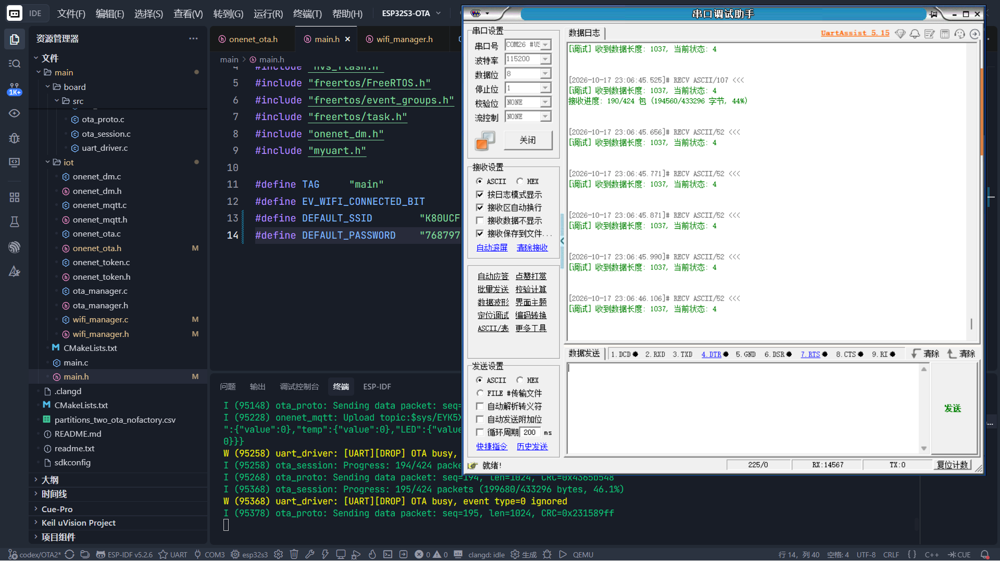
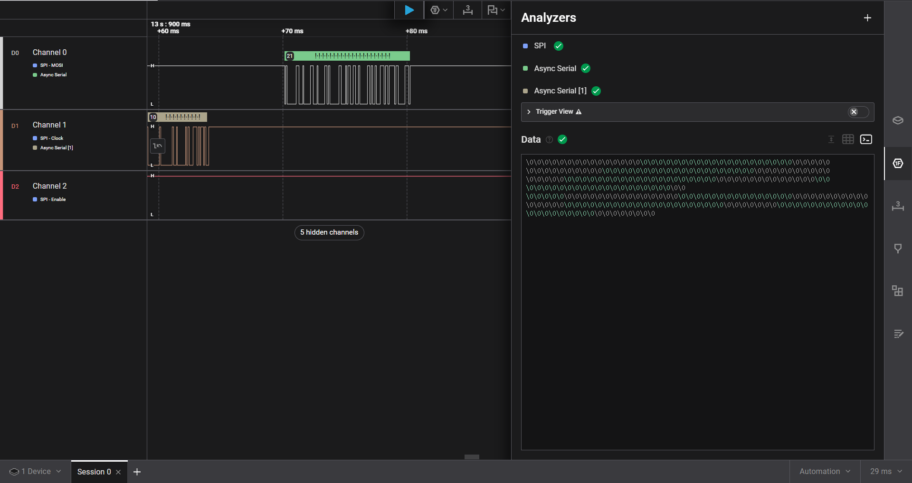
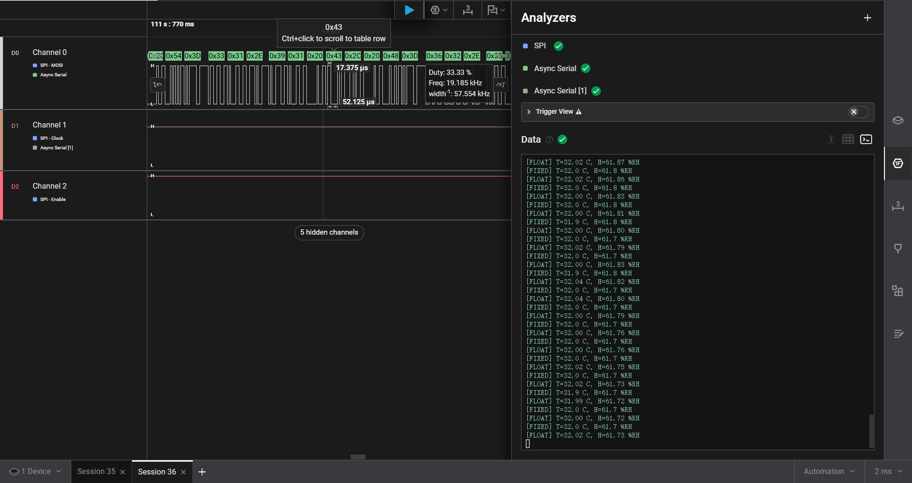

# 关键故障复盘

本页保留两次最能体现调试过程的问题。第一个发生在早期串口 IAP 原型，第二个发生在当前 ESP32-S3 + STM32F407 OTA 链路。

## 1. W25Q128 分页写入遗漏：跳转成功但 APP 无法运行

### 现象

早期 IAP 工程通过 XMODEM 接收固件，先写入 W25Q128，再复制到 STM32 内部 Flash。串口日志显示 Bootloader 已执行 APP 跳转，但 APP 没有正常运行。

### 定位过程

1. 检查 W25Q128 接线和基础读写，没有发现明显硬件异常。
2. 使用 ST-LINK Utility 读取 STM32 内部 APP 区。
3. 把读出的内存与正确 BIN 逐段对比，发现目标镜像周期性夹杂连续 `0xFF`。
4. 继续沿“串口接收 → 外部 Flash → 内部 Flash”逆向排查，确认内部 Flash 只是复制了已经损坏的外部 Flash 镜像。

### 根因

旧代码每接收 8 个 128 字节 XMODEM 包，会得到 1024 字节缓存。理论上应该连续写入 4 个 256 字节页，但循环条件写成：

```c
for (i = 0; i < (W25Q128_PAGE_SIZE / 256); i++)
```

`W25Q128_PAGE_SIZE` 本身就是 256，因此循环只执行 1 次。每组 1024 字节只写入前 256 字节，下一组又直接从后面的块地址继续，固定留下 768 字节空洞。尾包还使用整页写接口，不足 256 字节时会把无效填充值一起写入。

### 修复

- 完整 1024 字节缓存固定循环 4 次，连续写 4 页。
- 页地址统一按“块基址页号 + 组内页偏移”计算，明确区分块、页和字节。
- 尾包先计算真实剩余长度，只写有效页；最后一页使用支持可变长度的页写接口。
- 修复后重新做分段回读和 CRC32 对比，确认 W25Q128 和内部 APP 镜像连续。

错误循环和修复循环已经整理成可直接打开的对比源码：

- [`iap_flash_write_compare.c`](code-comparison/iap_flash_write_compare.c)

文件中的历史错误实现使用 `#if 0` 禁用，不会进入当前工程的编译结果。

### 对比证据

<table>
  <tr>
    <td></td>
    <td></td>
    <td></td>
  </tr>
</table>

这次故障说明：**执行到跳转代码只能证明控制流走到了这里，不能证明 APP 镜像正确。** 固件经过多级存储时，每一级都应有回读或 CRC 证据。

> 证据边界：早期 IAP 原型不属于当前正式仓库。故障现象、ST-LINK Utility 对比和修复结论来自当时保留的工程与排障记录；“写 256 字节、空 768 字节”的固定模式可由旧循环和页大小直接推导。

## 2. `vTaskSuspend` 冻结持锁任务：第二次 OTA 永久卡住

### 现象

第一次 OTA 失败后再次发起升级，ESP32 永久停在：

```text
Step 2: Sending handshake confirm...
```

没有新的超时或重试日志，但 MQTT 仍然在线。因此不是整机死机，而是 OTA 任务阻塞在 UART 驱动内部。

### 根因链路

1. 旧方案在 OTA 期间用 `vTaskSuspend()` 挂起普通 UART 接收任务。
2. 第一次会话结束后，UART 事件队列可能残留 NACK、ABORT-ACK 等过期 `UART_DATA` 事件。
3. 接收任务恢复后拿到旧事件，并进入 `uart_read_bytes()`；此时可能持有 UART 驱动内部接收互斥锁。
4. 第二次 OTA 再次调用 `vTaskSuspend()`，任务可能正好被冻结在持锁区间。
5. OTA 任务调用 `uart_flush_input()` 清理输入，需要同一把锁，于是永久等待。

### 修复

废弃 suspend/resume，改用 `volatile bool g_ota_uart_busy` 管理串口所有权：

- OTA 开始前置位忙标志。
- 接收任务保持运行，继续消费 UART 事件，但 OTA 期间不读取 ring buffer。
- OTA 收尾时释放忙标志，再清空接收数据并重置事件队列。
- UART 业务接收和 OTA 接收不再通过“强行冻结任务”切换。

当前实现位置：

- [`ota_session.c`](../../ESP32S3-OTA/main/board/src/ota_session.c)
- [`uart_driver.c`](../../ESP32S3-OTA/main/board/src/uart_driver.c)

`ota_session.c` 已从旧版 Git 记录恢复 `vTaskSuspend()`/`vTaskResume()` 原始调用，并用 `#if 0` 禁用；打开函数即可与当前 `g_ota_uart_busy` 标志门控方案上下对比。

这次故障说明：**不能挂起一个可能持有互斥锁的任务。** RTOS 无法保证任务被挂起时停在哪一行；涉及驱动锁、队列和阻塞 API 时，应设计明确的资源所有权和退出顺序。

## 3. 其他调试证据

<table>
  <tr>
    <td align="center"><br>固件 UART 传输</td>
    <td align="center"><br>波特率错误定位</td>
  </tr>
  <tr>
    <td colspan="2" align="center"><br>SHT30 Modbus 请求与响应观察</td>
  </tr>
</table>
