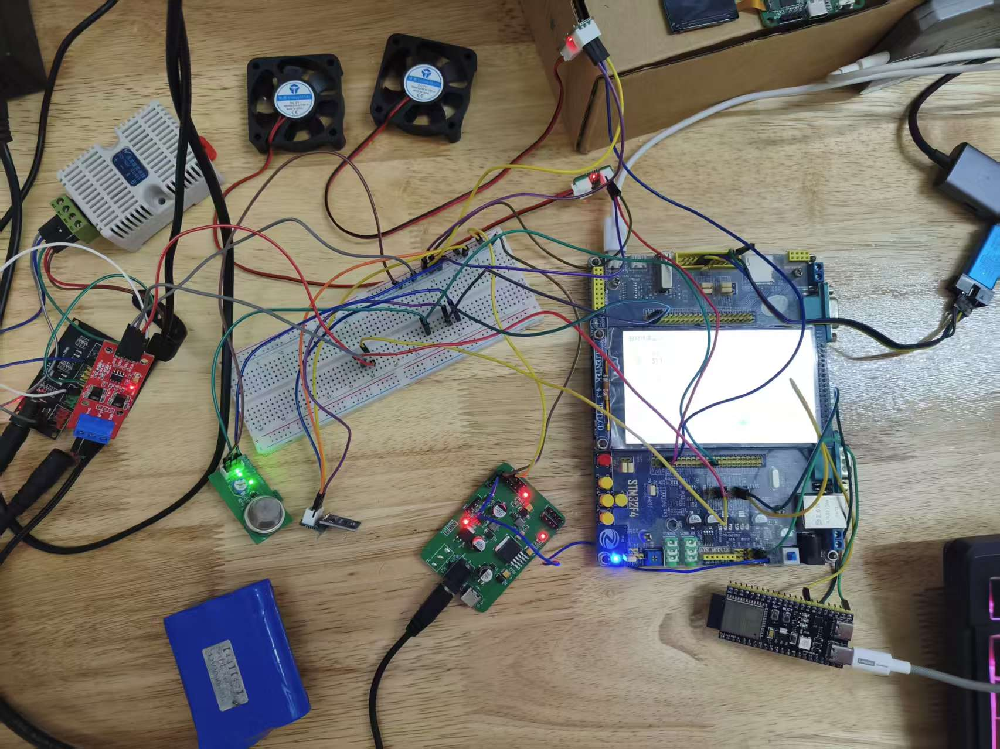
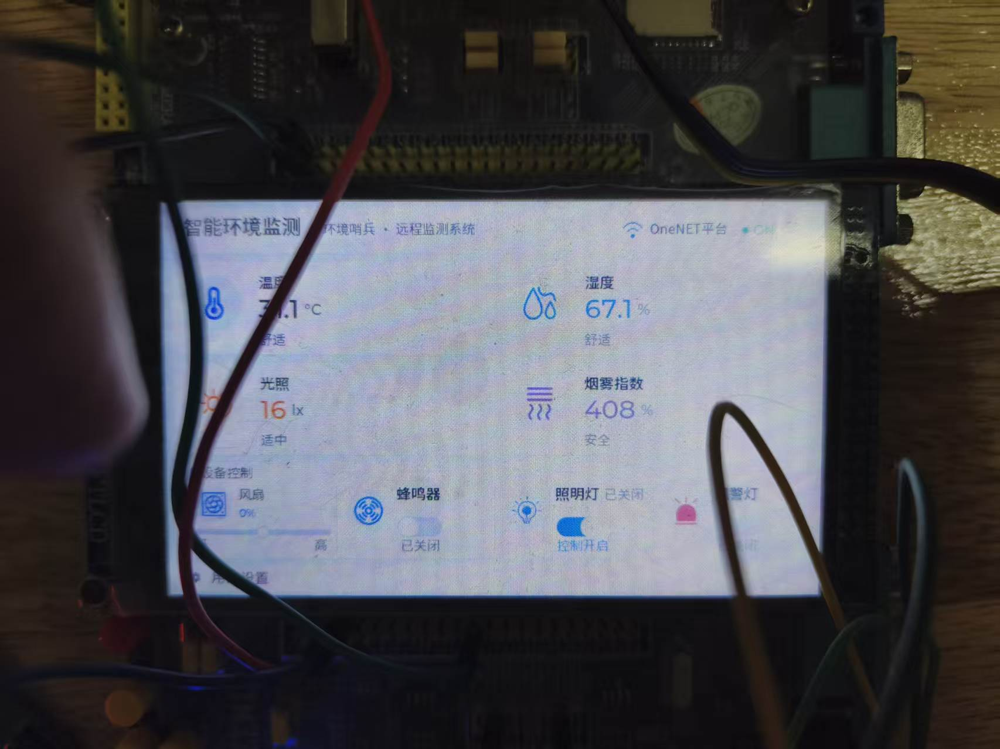
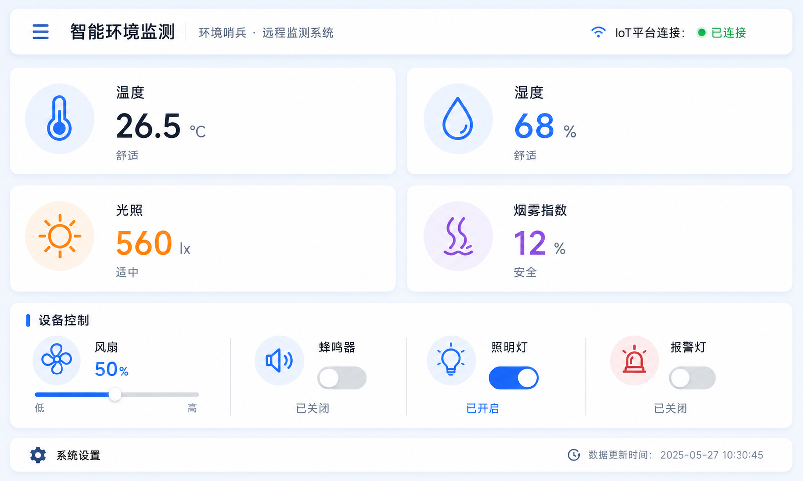
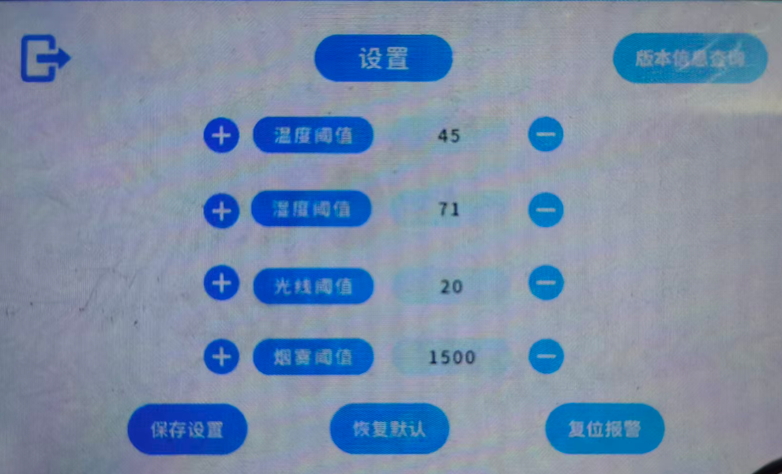
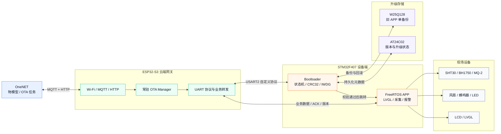
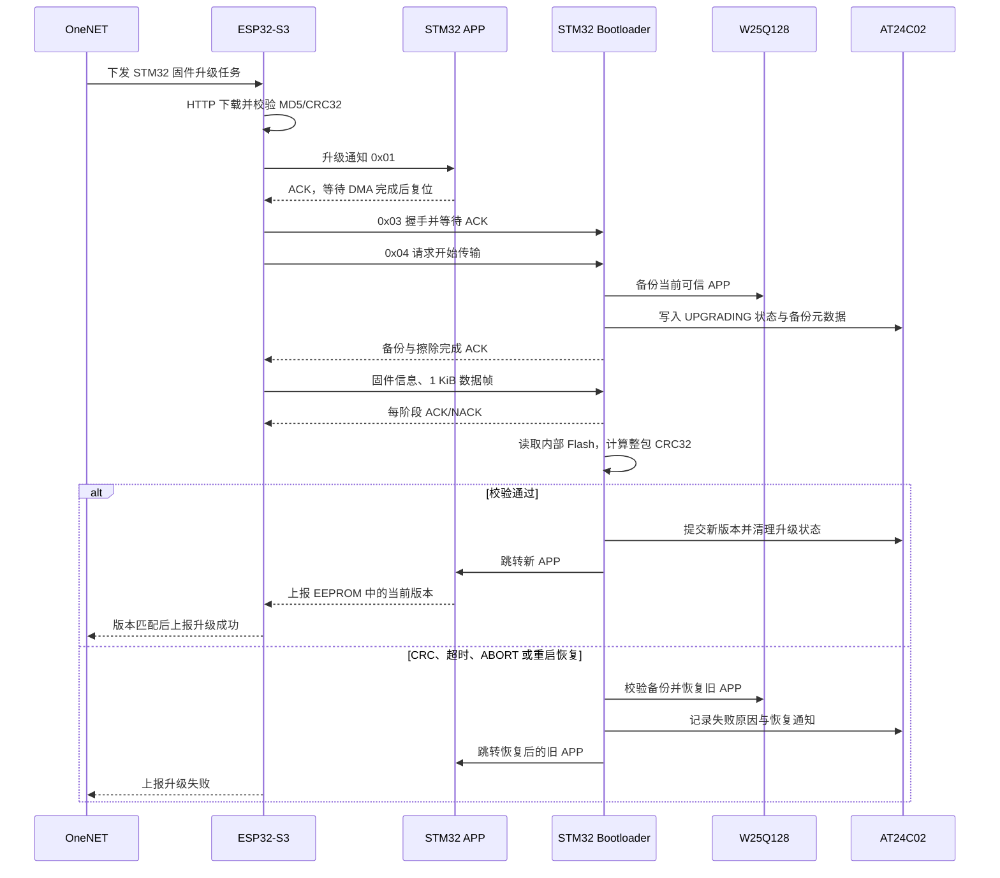

# ESP32-S3 + STM32F407 双 MCU 可靠 OTA 与环境监测终端

这是一个由 **ESP32-S3 云端网关**与 **STM32F407 设备端**组成的双 MCU 嵌入式项目。ESP32-S3 负责 OneNET 接入、HTTP 固件下载和 UART 升级调度；STM32F407 负责 Bootloader、固件回滚、FreeRTOS 业务、LVGL 界面、传感器采集和执行器控制。

> 项目围绕双 MCU OTA 的接收、校验、回滚和版本闭环实现，并通过串口故障注入、镜像 CRC 与实机日志验证结果。

最新实机验证为 **2.0.7 → 2.0.8**：STM32 接收 433356 字节并通过整体 CRC32，ESP32 确认新版 APP，OneNET 确认升级成功。新增 Python 串口测试用于验证拆帧、粘帧、故障回滚和恢复后再次升级，详见 [本次验证记录](DOC/verification/2026-10-31-uart-python-ota.md)。

## 项目亮点

- 打通 `OneNET → ESP32-S3 → UART → STM32 Bootloader → APP` 的完整 OTA 链路。
- 采用“内部 Bootloader + 单 APP 区 + W25Q128 单备份”方案，支持升级前备份、异常回滚和掉电恢复。
- 自定义 UART 协议包含阶段状态机、ACK/NACK、ABORT、有界重试、逐帧 CRC32 和整包 CRC32。
- STM32 使用“DMA 搬运 → 累计式软件环 → 按长度提帧 → 状态与 CRC 检查”，支持已实测的数据帧拆分和相邻两帧粘连。
- Python 可替代串口主站执行故障注入，分别记录用例结果、ABORT 收尾、恢复 CRC 和阶段耗时。
- STM32 APP 基于 FreeRTOS + LVGL，完成 SHT30 Modbus、BH1750、MQ-2、风扇、蜂鸣器和灯光控制。
- 保留正常升级、CRC 失败、主动中止、升级中断电、IWDG 恢复和版本回查等实机验证记录。
- 复盘两次代表性问题：W25Q128 分页写入导致固件碎片化，以及 `vTaskSuspend` 冻结持锁任务导致 OTA 重试死锁。

## 实物与界面

<table>
  <tr>
    <td align="center"><br>整机与调试环境</td>
    <td align="center"><br>STM32 LVGL 实机界面</td>
  </tr>
  <tr>
    <td align="center"><br>环境监测首页</td>
    <td align="center"><br>阈值设置页面</td>
  </tr>
</table>

## 系统架构



### OTA 主流程



## 双 MCU 职责

| 模块 | 主要职责 |
|---|---|
| ESP32-S3 | 连接 Wi-Fi/OneNET；检查 OTA 任务；通过 HTTP 下载固件到 SPIFFS；同步计算 MD5/CRC32；通过 UART 向 STM32 发送固件；上报升级结果和环境数据。 |
| STM32 Bootloader | 完成二次握手、旧 APP 备份、内部 Flash 擦写、协议状态机、逐帧/整包 CRC32、异常回滚、IWDG 保护和 APP 跳转。 |
| STM32 APP | 运行 FreeRTOS 与 LVGL；采集环境数据；执行报警和风扇控制；与 ESP32 交换业务帧；从 AT24C02 读取并上报当前 APP 版本。 |

## 可靠性设计

| 风险 | 当前处理方式 |
|---|---|
| 下载文件损坏 | ESP32 下载时校验 OneNET 提供的 MD5，同时流式计算标准 CRC32。 |
| UART 帧损坏 | 固件信息帧和每个数据帧分别带 CRC32；错误通过 NACK 返回明确原因。 |
| 半帧或多帧一起到达 | 按命令和协议长度等待完整帧，每次只消费一帧并保留后续字节；阶段超时仍有效。 |
| 内部 Flash 写入不完整 | STM32 写完后重新读取整个 APP 区，与固件期望 CRC32 比对。 |
| 重试失控或双方状态错位 | ACK/NACK、ABORT 和阶段超时约束会话；设备端恢复后再次升级已验证，ESP32 异常整次重试仍有后续改进项。 |
| 擦除后掉电或系统复位 | 升级前把可信 APP 备份到 W25Q128，并在 AT24C02 记录 `UPGRADING`；重启后优先恢复旧镜像。 |
| Bootloader 长耗时流程卡死 | Bootloader 启动 IWDG，在擦除、写入、备份和 CRC 过程中设置明确喂狗点；APP 接管同一看门狗。 |
| ESP32 单独重启后版本丢失 | ESP32 可发送 `66 09 BB` 请求，运行中的 APP 重新读取并上报持久化版本。 |
| 多任务争用 UART | STM32 APP 使用单发送者任务；ESP32 OTA 期间使用串口所有权标志，不挂起可能持锁的 UART 任务。 |

> 当前并不是 STM32 内部双 Bank A/B 轮换。内部 Flash 分为 64 KiB Bootloader 和 960 KiB APP；W25Q128 只保存一份升级前的可信 APP 镜像。

## STM32 APP

- SHT30 RS485 Modbus RTU 温湿度采集，内部按放大 10 倍的定点数保存一位小数。
- BH1750 光照采集与 MQ-2 烟雾 ADC 采集。
- 双路风扇 PWM、蜂鸣器、报警灯和照明灯控制。
- 温湿度、烟雾和光照阈值配置，并保存到非易失存储。
- 约 2 秒双向去抖；烟雾报警优先级最高，可强制风扇 100%。
- 传感器失效后清除有效标志，UI 显示 `NC`，报警引擎不再使用旧数据产生新报警。
- LVGL 首页、阈值设置页和 IoT 在线状态显示。

任务主线为：

```text
main.c
  └─ MX_FREERTOS_Init()
      ├─ AppTasks_Create()
      │   ├─ SHT30Task
      │   ├─ SmokeTask
      │   ├─ LightTask
      │   └─ AlarmEngineTask    <- 执行器最终写入者
      ├─ USART2_Transmit_Task   <- 业务帧单发送者
      └─ LVGLTask               <- 界面刷新
```

## 实机验证状态

2026-10-31 新增验证重点如下；[详细记录与公开证据](DOC/verification/2026-10-31-uart-python-ota.md)包含运行摘要、日志摘录及覆盖边界。

| 本次用例 | 结果 |
|---|---|
| 8+1029 字节拆帧、七段拆帧，间隔 50 ms | 完整接收、整体 CRC 与 APP 版本通过。 |
| 相邻末两帧一次提交，共 1218 字节 | 收到两次 ACK，短尾包和整体 CRC 通过。 |
| 整体 CRC 拒收、主动 ABORT、数据超时 | 旧镜像 CRC 恢复一致，三类恢复后均直接完成新一轮正常升级。 |
| 212/424 包后实际断电一次 | 上电识别未完成升级，恢复旧 APP 2.0.7。 |
| ESP32-S3 → STM32 正常 OTA 一次 | 新版 2.0.8、CRC `BE9E415E`、云端成功结果和后续 MQTT 通信确认。 |

以下为已有历史验证，未在本次发布操作中全部重跑：

| 用例 | 状态 | 证据边界 |
|---|---|---|
| 旧基线迁移与 APP 跳转 | 已验证 | 已记录向量表、镜像 CRC 和跳转日志。 |
| 正常 OTA | 已验证 | 已覆盖下载、备份、擦写、整包 CRC、新 APP 启动和结果上报链路。 |
| 固件整体 CRC 失败 | 已验证 | STM32 返回 NACK，ESP32 发送 ABORT，Bootloader 恢复旧镜像。 |
| 传输中主动 ABORT | 已验证 | Bootloader 回滚后旧 APP 可重新启动。 |
| 擦除或传输阶段断电 | 已验证 | 重启后识别未完成升级并从 W25Q128 恢复。 |
| IWDG 卡死恢复 | 已验证 | 擦除 APP 后停止喂狗，复位后完成回滚。 |
| APP 版本查询闭环 | 已验证 | ESP32 单独重启后可重新查询 STM32 版本。 |
| SHT30 通讯与 LVGL 一位小数显示 | 用户实机确认 | 已看到合法 Modbus 请求、响应和正确解析；没有保存完整异常场景日志。 |
| v2.0.0 正式 OTA 回归 | 用户实机确认 | 已确认新 APP 启动、版本读取和结果上报阶段；没有保存完整双端原始日志。 |

截图、日志边界和待补测试见 [实机验证记录](DOC/verification/README.md)。

## 两次关键故障复盘

### 1. W25Q128 分页写入遗漏，导致 APP 镜像碎片化

早期串口 IAP 原型中，日志显示已经跳转 APP，但 APP 无法运行。使用 ST-LINK Utility 读取 STM32 内部 APP 区并与正确 BIN 对比后，发现镜像周期性出现大片 `0xFF`。

根因是 1024 字节缓存本应写 4 个 256 字节页，旧循环却只执行 1 次；每组只写入前 256 字节，随后地址直接跨到下一组，固定留下 768 字节空洞。尾包还存在把无效填充值按整页写入的问题。

修复后统一了“块、页、字节”三个地址单位，完整缓存固定连续写 4 页，尾页只写真实有效长度，并通过分段回读和 CRC32 再次确认镜像连续。


### 2. `vTaskSuspend` 冻结持锁任务，导致 OTA 二次重试死锁

第一次 OTA 失败后再次升级，ESP32 永久停在 `Step 2: Sending handshake confirm...`，但 MQTT 仍在线。最终定位到 UART 接收任务可能在持有 ESP-IDF UART 驱动内部 `rx_mux` 时被 `vTaskSuspend()` 冻结；OTA 任务随后调用 `uart_flush_input()` 等待同一把锁，双方永久僵住。

修复方案是取消 suspend/resume，改用 `g_ota_uart_busy` 管理串口所有权：OTA 期间接收任务继续运行并消费事件，但不读取 ring buffer；会话结束后再按顺序释放忙标志、清空数据和重置事件队列。

这两个问题分别说明：

- “已经执行跳转”不等于“APP 镜像完整”，存储链路要逐级回读验证。
- 不能挂起一个可能持有互斥锁的任务，驱动共享资源应使用所有权和可控退出流程。

完整证据、代码片段和定位过程见 [故障复盘](DOC/debugging/README.md)。

## Flash 与协议

### STM32 内部 Flash

| 区域 | 地址 | 大小 |
|---|---:|---:|
| Bootloader | `0x08000000` | 64 KiB |
| APP | `0x08010000` | 960 KiB |

### ESP32 ↔ STM32

- 物理链路：USART，`115200 8N1`，3.3 V TTL，共地。
- OTA 帧：`0x66` 帧头，`0xBB` 帧尾；数据帧最大载荷 1024 字节。
- 业务帧：固定 8 字节，`55 | type | data[5] | BB`。
- 完整引脚、命令码、帧格式和代码依据见 [双端引脚与通信协议](DOC/architecture/ESP32S3_STM32F407_引脚清单与通信协议.txt)。

## 技术栈

| 分类 | 使用内容 |
|---|---|
| 云端与网络 | OneNET、MQTT、HTTP、物模型、OTA 任务接口 |
| 网关端 | ESP32-S3、ESP-IDF、FreeRTOS、SPIFFS、UART、Wi-Fi |
| 设备端 | STM32F407ZGT6、STM32 HAL、FreeRTOS、LVGL 8.3.11、Keil MDK、STM32CubeMX |
| 存储 | STM32 内部 Flash、W25Q128、AT24C02 |
| 传感器 | SHT30 RS485 Modbus、BH1750、MQ-2 |
| 调试工具 | ST-Link、串口日志、逻辑分析仪、示波器、万用表、ST-LINK Utility |

## 仓库结构

```text
bootloader_OTA/
├─ ESP32S3-OTA/                         ESP32-S3 云端网关工程
│  └─ main/
│     ├─ board/                         UART、OTA 协议、CRC32
│     └─ iot/                           Wi-Fi、MQTT、OneNET 与 OTA Manager
├─ STM32-OTA/
│  ├─ testB3/                           STM32F407 Bootloader 正式工程
│  └─ A区智能哨兵环境监测系统/             FreeRTOS + LVGL 正式 APP
├─ Python_test/                         Python 串口测试、采集、故障注入和离线检查
├─ DOC/
│  ├─ architecture/                     架构、引脚和协议
│  ├─ debugging/                        故障复盘与调试证据
│  ├─ development-notes/                开发过程和历史记录
│  ├─ images/                           实物与 UI 图片
│  └─ verification/                     实机验证材料
└─ README.md
```

历史测试工程、备份工程和本地打磨记录已经从公开主线移除。

## 关键代码入口

| 功能 | 文件 |
|---|---|
| ESP32 常驻 OTA Manager | [`ota_manager.c`](ESP32S3-OTA/main/iot/ota_manager.c) |
| OneNET 检查、下载与结果上报 | [`onenet_ota.c`](ESP32S3-OTA/main/iot/onenet_ota.c) |
| ESP32 UART OTA 会话 | [`ota_session.c`](ESP32S3-OTA/main/board/src/ota_session.c) |
| ESP32 UART 接收与所有权门控 | [`uart_driver.c`](ESP32S3-OTA/main/board/src/uart_driver.c) |
| STM32 Bootloader 状态机 | [`ota_core.c`](STM32-OTA/testB3/Drivers/bootloader_drivers/src/ota_core.c) |
| STM32 串口软件环 | [`command.c`](STM32-OTA/testB3/Drivers/bootloader_drivers/src/command.c) |
| Python 测试与复现命令 | [`Python_test/README.md`](Python_test/README.md) |
| 备份、回滚与启动恢复 | [`ota_storage.c`](STM32-OTA/testB3/Drivers/bootloader_drivers/src/ota_storage.c) |
| STM32 APP 采集与报警任务 | [`APP_Tasks.c`](STM32-OTA/A区智能哨兵环境监测系统/Core/Src/APP_Tasks.c) |
| STM32 APP UART2 通讯任务 | [`uart2_comm.c`](STM32-OTA/A区智能哨兵环境监测系统/Core/Src/uart2_comm.c) |
| SHT30 Modbus 驱动 | [`modbus_th.c`](STM32-OTA/A区智能哨兵环境监测系统/Drivers/Module_driver/src/modbus_th.c) |

## 快速开始

1. 复制 `ESP32S3-OTA/main/credentials.example.h` 为本地 `credentials.h`，填写 Wi-Fi 和 OneNET 参数。`credentials.h` 已被 Git 忽略。
2. 在 `ESP32S3-OTA` 下使用 ESP-IDF 构建并烧录 ESP32-S3。
3. 使用 Keil 打开 `STM32-OTA/testB3/MDK-ARM/test1.uvprojx`，构建并烧录 Bootloader。
4. 使用 Keil 打开 `STM32-OTA/A区智能哨兵环境监测系统/MDK-ARM/LVGL_RTOS_DOME5.uvprojx`，构建正式 APP。该工程链接地址必须保持为 `0x08010000`。
5. 先确认 APP 可独立启动和上报版本，再通过 OneNET 下发匹配版本号、大小和 MD5 的 STM32 BIN 固件。

串口专项可先按 [Python 测试说明](Python_test/README.md)复现，再接回 ESP32 执行云端 OTA。实机结果来自上述已执行测试；本次发布整理只运行离线检查，没有再次编译、烧录或连接真实串口。

## 已知边界

- 当前是 W25Q128 单备份回滚，不是内部双 Bank A/B 无缝切换。
- 已有 MD5/CRC32 完整性检查，但尚未实现数字签名、可信启动和防降级。
- OTA 协议尚未实现会话 ID、断点续传和掉线续传。
- ESP32 回滚后的整次自动重试仍需统一 APP/Bootloader 状态判断；跨轮任务缓存复用未完成。
- 简单命令/信息帧拆分、其他分段间隔、重复帧粘连和容量边界尚未全部实测。
- SHT30 当前使用阻塞式 UART 收发；故障时依靠超时退出和下一采集周期重试。
- OneNET 温湿度属性仍为整数，0.1 精度只保留在 STM32 内部和 LVGL。
- W25Q128 备份损坏保护逻辑已经实现，但主动破坏备份的实机故障注入尚未执行。
- 风扇对 MQ-2 ADC 的干扰、BH1750 长时间漂移和 RS485 断线恢复仍需继续测量。
- OTA 过程视频是约 92.5 MB 的本地演示素材，不进入源码仓库；公开时应压缩后放到 GitHub Release 或视频平台，再把链接补到这里。

## 文档导航

- [DOC 文档总览](DOC/README.md)
- [APP 架构与功能方案](DOC/architecture/A区APP功能扩展方案.md)
- [双端引脚与通信协议](DOC/architecture/ESP32S3_STM32F407_引脚清单与通信协议.txt)
- [故障复盘](DOC/debugging/README.md)
- [实机验证记录](DOC/verification/README.md)
- [串口组帧与 Python OTA 验证](DOC/verification/2026-10-31-uart-python-ota.md)
- [Python 测试运行说明](Python_test/README.md)
- [STM32 APP 开发与验证记录](DOC/development-notes/STM32_A区APP开发与实机验证记录.md)

## 许可说明

仓库包含 STM32 HAL、CMSIS、FreeRTOS、LVGL 等第三方代码，各部分继续遵循其原始许可。项目根目录当前未提供统一开源许可证；复制、分发或商用前，请分别核对对应组件许可。
